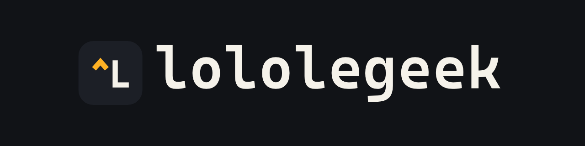
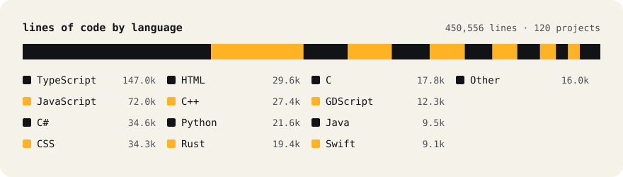

  

Desktop apps, games and the tools between. Most of it runs offline, on the machine in front of you.

**120 projects · 450,556 lines · 877 commits · 21 languages** — [lololegeek.github.io](https://lololegeek.github.io)

*Other* covers Lua and Luau, Kotlin, Dart, Shell, PowerShell, QML, CMake and a few more.

## Desktop apps

| Project | What it is | Built with |
|---|---|---|
| [Nexolume](https://github.com/Lololegeek/nexolume) | Offline office suite: Writer, Sheets and Slides · [site](https://lololegeek.github.io/nexolume-site/en/) | Rust, C#, .NET 10, Avalonia |
| [ClipForge](https://github.com/Lololegeek/ClipForge) | Game replay capture and clip editor, GPL-3.0 · [site](https://lololegeek.github.io/ClipForge/) | C++20, Qt Quick, libobs, FFmpeg |
| LCut | Video editor | C++20, Qt Quick, MLT, FFmpeg |
| [ProjectHub](https://github.com/Lololegeek/ProjectHub) | Project library and launcher | C#, WinUI 3 |
| [GogolCrosshairs](https://github.com/Lololegeek/gogolcrosshairs) | Crosshair overlay | Electron |
| NovaExplorer | File manager | C#, WinUI 3 |

## Games

| Project | What it is | Built with |
|---|---|---|
| Server Tycoon | Management game: from one rack in a bedroom to a data centre | Godot 4, GDScript |
| Nova City RP | Garry's Mod DarkRP server | Lua |

## Minecraft

| Project | What it is | Built with |
|---|---|---|
| [UMCE](https://github.com/Lololegeek/UMCE) | Server compute and optimization engine | Java, Fabric |
| [LoloMC GUI](https://github.com/Lololegeek/LoloMC-GUI) | Loader-neutral GUI library with XML, CSS and a visual editor | Java, TypeScript |
| [Lolo Minecraft Launcher](https://github.com/Lololegeek/lolo-minecraft-launcher) | Vanilla, Fabric, Forge and NeoForge launcher · [site](https://lolo-minecraft.vercel.app) | C#, .NET |
| Valoria RP | Roleplay server economy, launcher, backend and site | Java, Fabric, Electron, TypeScript, Prisma |

## Tools and systems

| Project | What it is | Built with |
|---|---|---|
| [Live Server Speed Edition](https://github.com/Lololegeek/live-server-speed-edition) | VS Code extension · [Marketplace](https://marketplace.visualstudio.com/items?itemName=Lololegeek.live-server-speed-edition) | TypeScript |
| [pulse-os](https://github.com/Lololegeek/pulse-os) | Gaming Linux distro | Fedora bootc, Gamescope, C++ |
| AssetFlow | Roblox asset reuploader for animations, sounds and meshes, with API and bots · [site](https://assetflow-website.com) | TypeScript, Lua |
| GreenVita PS3 | Cloud gaming client for the PS3 | C, PS3 SDK |
| [LoloServer](https://github.com/Lololegeek/LoloServer) | Container manager | Python |
| [rbxlx-to-rojo](https://github.com/Lololegeek/rbxlx-to-rojo) (fork) | Patched to read Roblox 2024–2026 place formats | Rust |

## Web

| Project | What it is | Built with |
|---|---|---|
| LoloAI | AI chat with tools | Next.js, AI SDK, Prisma |
| FrenchWord | Multiplayer word game | TypeScript, Express, WebSocket |
| [Life Simulator](https://github.com/Lololegeek/Life-simulator) | Life simulation · [play](https://lololegeek.github.io/Life-simulator/) | TypeScript |
| [LoloLinks](https://github.com/Lololegeek/LoloLinks) | Link shortener | Node.js, Express, SQLite |

Names without a link are private or not published yet.

## Stack

**Languages** TypeScript · JavaScript · C# · C++ · C · Rust · Python · Java · GDScript · Swift · Lua  
**Desktop** Qt Quick · Avalonia · WinUI 3 · Electron  
**Web** React · Next.js · Tailwind · Express · Prisma · WebSocket  
**Games and mods** Godot 4 · Fabric · Roblox (Rojo)  
**Media** FFmpeg · libobs · MLT  
**Ops** Docker · Linux (Fedora bootc) · GitHub Actions
